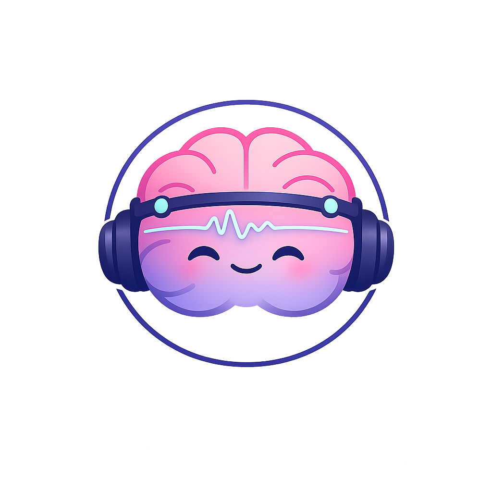
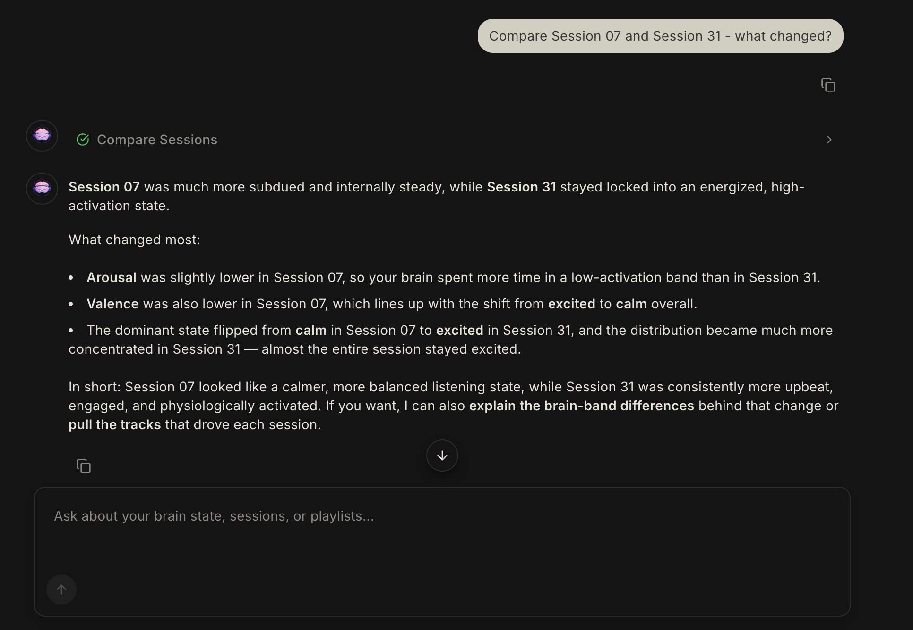
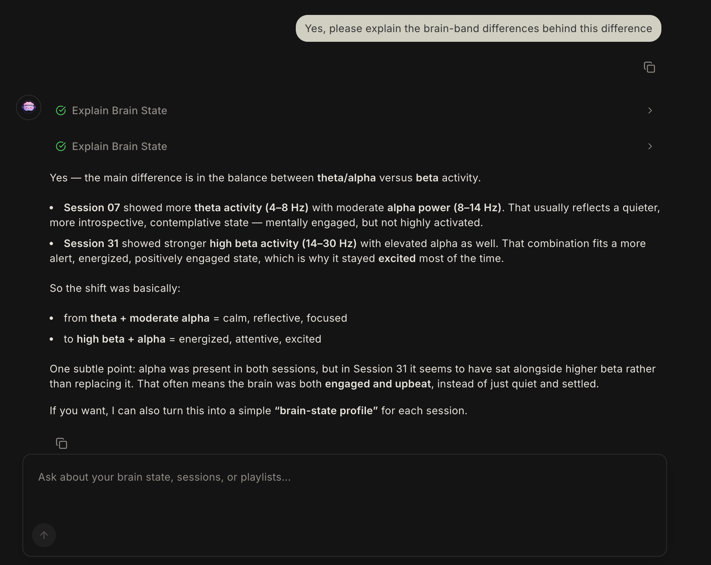

<div align="center">
  
  <h1>CortexDJ</h1>
  <p>An AI-powered EEG classifier that detects emotional states during music listening and curates Spotify playlists grounded in what your brain actually did.</p>

  [](https://github.com/LukeMainwaring/cortexdj/actions/workflows/ci.yml)
</div>

<div align="center">
  
</div>

## Why CortexDJ?

Music shapes your brain state, and your brain state shapes what music you want next. CortexDJ closes the loop: it classifies your EEG into emotion quadrants (relaxed / calm / excited / stressed) and curates Spotify playlists grounded in what your brain actually did while listening — not what you think you listened to, not what a recommender thinks people like you want.

## Features

- **Brain state classification** — Per-segment arousal/valence scores mapped to four emotion quadrants (relaxed / calm / excited / stressed) for every 4-second EEG window
- **A classifier you can explain weight by weight** — One linear layer on differential entropy in four frequency bands, calibrated to each DEAP participant and scored on trials it never saw; its training code is in the repo and runs on a laptop in about a minute
- **Agentic orchestration** — A Pydantic AI agent decides which tools to call per query, enabling multi-step reasoning across session analysis, playlist curation, and track retrieval
- **Persistent brain context** — Dominant mood / arousal / valence attached to the conversation thread, surviving page refreshes and flowing dynamically into the system prompt
- **Contrastive EEG↔CLAP retrieval** — Joint 512-d embedding between raw EEG and LAION-CLAP audio, served via pgvector HNSW cosine search (proof-of-concept; see [Limitations](#limitations))
- **Emotion trajectory visualization** — Animated SVG path through Russell's affect space, plus a stacked band-power chart of the theta / alpha / beta / gamma activity the classifier reads
- **Brain-grounded playlist curation** — Queries historical EEG classifications to find tracks that consistently triggered a target mood, then builds a Spotify playlist with a user-confirmation gate
- **Inline tool transparency** — Every agent step renders an expandable tool-call panel with input parameters, output JSON, and a domain-specific visualization beneath

## Demo Workflows

These prompts showcase what CortexDJ can do that general-purpose chatbots can't. See [docs/DEMO_WORKFLOWS.md](docs/DEMO_WORKFLOWS.md) for the full catalog.

### Cross-session brain pattern comparison

> "Find me one session where I was calm and focused and one session where I was excited throughout"
>
> "Compare Session 07 and Session 31 — what changed?"
>
> "Yes, please explain the brain-band differences behind this difference"

<div align="center">
  
  &nbsp;&nbsp;
  
</div>

Side-by-side comparison of brain responses across two different listening sessions. Reveals how brain states differ across different music or different days.

### Brain-state track retrieval

> "Analyze Session 27"
>
> "Find me new songs that match how I was feeling during Session 27"

<div align="center">
  
</div>

Retrieving tracks from brain state embeds the session's EEG into the joint EEG↔CLAP space and returns top-k tracks ranked with cosine-similarity bars and inline 30-second iTunes previews for smoother, accurate music discovery.

## Why a per-participant classifier + agent?

- **Quadrant classifier**: One linear layer on 128 band features (differential entropy of 32 channels in theta, alpha, beta and gamma), with two outputs, arousal and valence. Each DEAP participant gets their own models, trained only on their own trials and scored on trials those models never saw: a model trained on other people reads a new one at chance on DEAP, for every model family, so the app is a decoder calibrated to one person. The headline is balanced accuracy per axis against a chance of 0.50. `get_model_info` reports the loaded checkpoint's features, split, figures and training recipe.
- **Contrastive encoder**: CBraMod, a transformer pretrained on the TUEG corpus, is the backbone of the EEG↔CLAP encoder behind track retrieval.
- **Agent**: Orchestrates classification, analysis, and playlist curation. A query like _"build me a relaxation playlist"_ triggers brain state querying, track filtering by arousal/valence, and Spotify integration — multi-step reasoning that a static pipeline can't do.

## Quick Start

### Prerequisites

- [Docker](https://docs.docker.com/get-docker/) (for PostgreSQL and the backend)
- [uv](https://docs.astral.sh/uv/) (Python package manager)
- [pnpm](https://pnpm.io/) (Node package manager)
- [Node.js](https://nodejs.org/) 26+
- [GitHub CLI](https://cli.github.com/) (to download the contrastive encoder's checkpoint)
- Anthropic API key

### Setup

```bash
# Clone and configure
git clone https://github.com/LukeMainwaring/cortexdj.git
cd cortexdj
cp .env.sample .env
# Edit .env with your ANTHROPIC_API_KEY

# Backend setup
uv sync --directory backend
uv run --directory backend pre-commit install

# Download DEAP dataset (see backend/data/DEAP_SETUP.md)
# Place .dat files in backend/data/deap/

# Download the contrastive encoder's checkpoint (the quadrant classifier's is trained below)
./backend/scripts/download-checkpoints.sh

# Start PostgreSQL (port 5433) + backend (port 8003), then create the tables
docker compose up -d
./backend/scripts/migrate-docker.sh

# Train the quadrant classifier, then seed the database with sessions it scores
# (seeding takes about 3.5 minutes for the 32 DEAP files; a re-seed replaces each session)
uv run --directory backend train-classifier
uv run --directory backend seed-sessions

# Frontend setup
pnpm -C frontend install
pnpm -C frontend generate-client
pnpm -C frontend dev

# Visit http://localhost:3003
```

Spotify is optional: without it the app runs and the assistant's Spotify tools are unavailable. To use it, create an app at [developer.spotify.com/dashboard](https://developer.spotify.com/dashboard), register `http://127.0.0.1:8003/api/spotify/callback` as its redirect URI, put `SPOTIFY_CLIENT_ID` and `SPOTIFY_CLIENT_SECRET` in `.env`, and recreate the backend with `docker compose up -d backend`. Then connect your account under Settings → Spotify Settings in the sidebar; the assistant's Spotify tools appear once it is connected.

The track index that retrieval searches is built by `seed-track-index`, which cannot finish until the open ticket [audio-decoding 01](.scratch/audio-decoding/issues/01-decode-m4a-previews.md) is done, so a fresh setup has every feature except retrieval.

## Tech Stack

| Layer | Technology |
|-------|-----------|
| Frontend | Next.js 16, React 19, Tailwind CSS 4, shadcn/ui, TanStack Query |
| Chat UI | Vercel AI SDK (`useChat`), Streamdown |
| Visualization | Recharts (timeline + band-power charts), motion/react (animated trajectory), Radix Tabs, wavesurfer.js (preview waveforms) |
| Backend | FastAPI, Pydantic v2, async SQLAlchemy 2.0, Alembic |
| Agent | Pydantic AI with Anthropic (Claude) |
| ML | PyTorch (linear quadrant classifier, contrastive encoder), braindecode (CBraMod backbone), CLAP audio embeddings via transformers, librosa, scipy |
| EEG Processing | Butterworth band-pass (second-order sections), differential entropy, band variance |
| Database | PostgreSQL 18 + pgvector (HNSW cosine index) |
| Spotify | spotipy (OAuth 2.0) |
| Observability | Pydantic Logfire (FastAPI, SQLAlchemy, and agent traces) |
| DevOps | Docker Compose, GitHub Actions CI |
| Testing | pytest (unit and integration tiers), pydantic-evals (real-model evals) |
| Code Quality | Ruff, mypy (strict), import-linter, pre-commit, Biome/Ultracite |

## Limitations

The EEG↔CLAP contrastive retrieval path described above is a deferred research direction — at DEAP scale, 4-second EEG windows do not carry enough track-specific signal to align with LAION-CLAP audio embeddings. See [Deferred research: EEG↔CLAP contrastive retrieval](docs/ROADMAP.md#deferred-research-eegclap-contrastive-retrieval) for the evaluation and the directions that would make it tractable.

## Development

See [DEVELOPMENT.md](DEVELOPMENT.md) for setup details, checks and tests, evals, observability, and migrations.

## Roadmap

See [docs/ROADMAP.md](docs/ROADMAP.md) for planned features including SEED/AMIGOS dataset support, live Muse 2 BCI integration, and personalized fine-tuning.
