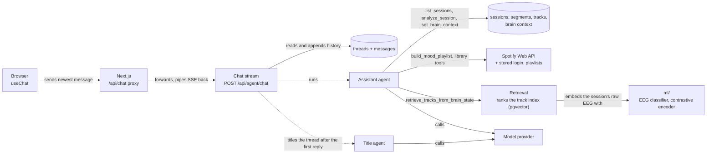

# Architecture guide

## Summary

CortexDJ is a chat app where a user talks to one assistant that can call tools over EEG recordings of people listening to music: `sessions` (EEG sessions, their analysis, and a thread's brain context), `spotify` (track search, the user's library, mood playlists), and `retrieval` (tracks matched to a session's EEG through a vector index). A Next.js frontend proxies each chat turn to a FastAPI backend, which stores the turn, runs a Pydantic AI agent against the thread's history, and streams the reply back as server-sent events. The one idea to remember: the backend is cut into feature slices that only meet at a few composition roots, and a new domain is a new slice.

## Topics

- [Slices and the dependency rule](slices-and-the-dependency-rule.md): how is the code organized, and what is allowed to import what?
- [One chat turn](one-chat-turn.md): what happens between the browser sending a message and the reply finishing?
- [The evaluation loop](the-evaluation-loop.md): how do you know the agent is getting better, and what does a run leave behind to look at?

## Diagram

## How it works

The backend package is `cortexdj`. A thin kernel (`core/`, `shared/`, `agents/`, `ml/`) holds what every feature shares, and each domain is a slice under `features/`: `chat` (threads, messages, title generation, and the streaming endpoint), `sessions` (EEG sessions, segments, tracks, and a thread's brain context: tables, routes, and the assistant's tools), `spotify` (the OAuth routes, the stored login, saved playlists, and the assistant's Spotify tools), and `retrieval` (the track index, the route and tool that rank it against a session's EEG, and the preview audio route). `ml/` is the inference code for the two EEG models, the quadrant classifier and the contrastive EEG-to-audio encoder; the app loads one checkpoint of each at startup, and a slice holds the loaded model.

A chat turn enters at `features/chat/stream.py`. It stores the user's message, loads the thread's history, gets the assistant from the registry in `agents/registry.py`, and streams the run back in the Vercel AI SDK format. The assistant is built once by `build_assistant` in `agents/assistant.py` from `ENABLED_CAPABILITIES`, the list in `agents/capabilities.py`; the sessions, spotify, and retrieval capabilities are its entries. `api.py` mounts each slice's router, registers the two startup hooks that load the models, and fills the two seams in `shared/` through which one slice reads another's data. Threads, messages, sessions, and the track index live in one Postgres database, and every route takes a session from `core/db.py` that commits when the request ends.

The frontend is a Next.js chat shell. `components/chat.tsx` sends only the newest message, `app/(chat)/api/chat/route.ts` forwards it, and `components/message.tsx` renders tool calls, mounting a richer panel when the tool's name is in `features/tool-panel-registry.ts`. The chat header renders whatever `features/header-slot-registry.ts` lists, which is how the brain-context badge gets there.

## Why it's built this way

`AGENTS.md` states the intent: a vertical slice (`sessions`) to copy when adding a domain, and small registries so a new router, capability, agent, or startup hook is one registration rather than edits scattered across `app.py`. The same file gives the dependency direction, and the rule for what a slice does when it needs something another slice owns: a one-slot seam in `shared/` that `api.py` fills.

The decisions that shaped specific parts are recorded as ADRs: how tests are tiered and where they may fake ([0001](../adr/0001-test-tiers-and-fakes.md)), why prompt caching is part of the shared recipe with each prompt split into static rules and per-run context ([0002](../adr/0002-prompt-caching-in-the-shared-recipe.md)), why the facts a trace is searched by ride on the agent run as metadata and nothing else is traced by hand ([0003](../adr/0003-run-metadata-not-a-custom-chat-turn-span.md)), and why the eval judges run on a model a tier above the agents, pinned apart from them ([0004](../adr/0004-eval-judges-a-tier-above-the-agents.md)).

## How to explain this

**In about a minute:**

> It's a chat app over EEG recordings of people listening to music. The user talks to one assistant, built with Pydantic AI, that has tools over the app's data: it can list, analyze, and compare EEG sessions, build Spotify playlists from the moods it finds, and retrieve tracks whose audio matches a session's EEG. The frontend is a thin Next.js chat UI that sends only the newest message; all the logic is in a FastAPI backend, which owns the conversation history, saves the user's turn before the model runs, and streams the reply back as server-sent events. The backend is organized as feature slices, each with its own model, service, routes, and agent tools, over a small kernel that includes the EEG model inference code. Slices never import each other; they meet in three small files that wire everything together, and where one slice needs another's data it goes through a small seam the wiring fills. Around that: tests in three tiers, an eval tier that measures the agent as it ships, and tracing through the standard instrumentation.

**Likely follow-ups:**

- **Where does state live?** In Postgres: the thread history and brain context per thread, the sessions, the Spotify login, and the track index. The two loaded models are held in process, one holder each. The browser holds nothing the server needs, so it sends only its newest message, and a regenerate reuses the stored turn.
- **How would you add a domain?** Copy `features/sessions/` on each side: model, schema, service, router, then tools and a capability, and register the router in `api.py` and the capability in `agents/capabilities.py`. The frontend side is a panel and one line in the tool-panel registry. If the new slice needs another slice's data, add a seam in `shared/` and register it in `api.py`.
- **How would you add another agent?** A builder that calls `build_agent` with its capabilities, one line in `agents/registry.py`, and, if it needs its own model, a setting resolved with `Settings.resolve_model`.

## Sources

Written at commit `87d6eba`.

- `backend/src/cortexdj/api.py`
- `backend/src/cortexdj/agents/capabilities.py`
- `backend/src/cortexdj/agents/registry.py`
- `backend/src/cortexdj/features/__init__.py`
- `frontend/features/tool-panel-registry.ts`
- `frontend/features/header-slot-registry.ts`

Watched for new topics:

- `backend/src/cortexdj/features/`
- `backend/src/cortexdj/agents/`
- `frontend/features/`
- `docs/adr/`
