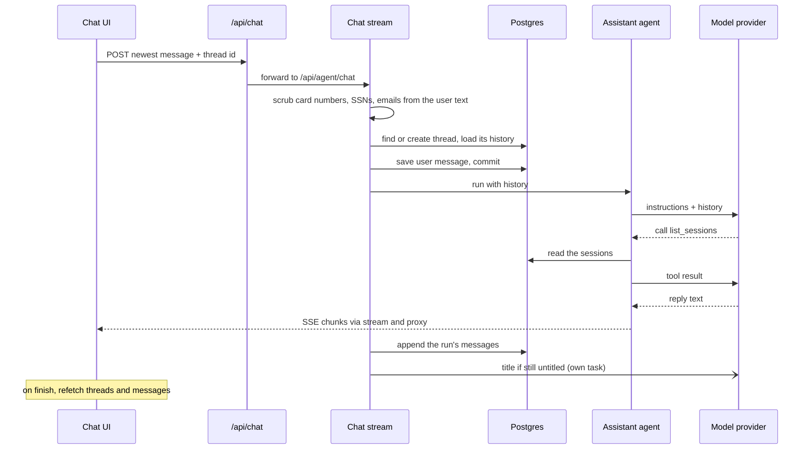

# One chat turn

## Summary

A turn starts with the browser sending only its newest message and ends with a streamed reply and the run's messages stored. In between, the backend saves the user's message, loads the history, and streams the agent's run back as server-sent events. The one idea to remember: the server owns the conversation, and it saves the user's turn before the model runs.

## Diagram

The example is a turn where the model chooses to list sessions. Many turns have no tool call.

## How it works

1. **Browser.** `frontend/components/chat.tsx` uses the `useChat` hook with a transport that sends the thread id and `messages.slice(-1)`: just the newest message. Every send goes through `startTurn`, which refuses to start a turn while one is submitted or streaming, keeps the draft, and says so, so a double submit cannot drop a message. `<Chat>` is keyed by thread id, so switching threads remounts it rather than leaving callbacks bound to the old one.
2. **Proxy.** `frontend/app/(chat)/api/chat/route.ts` forwards the body to the backend's `/api/agent/chat` and pipes the response body straight back, status and all, so a JSON `detail` from FastAPI reaches the UI unchanged.
3. **Prepare.** `stream_chat` in `features/chat/stream.py` builds the run input through `_ChatAdapter`. With the scrubbing feature kept, `build_run_input` replaces card numbers, Social Security numbers, and emails in the user's text with placeholders before anything else sees it. Through the chat service (`features/chat/service.py`), the handler finds or creates the thread (race-safe: two first turns on one id do not collide), loads the stored history, sanitizes the incoming message (dropping injected system prompts, unfetchable file references, and compaction parts), appends the user's message, and commits. One exception: when the request is a regenerate and the stored history already ends on that same user turn with no reply, the stored copy stands in. The turn is not stored again and is dropped from the history passed to the run, so the model sees it once.
4. **Run.** It hands the request to Pydantic AI's Vercel AI adapter with the assistant from the registry, the dependencies (the request's database session), the history, and the thread id as the conversation id. The agent calls the model, runs any tools the model asks for, and each event streams to the browser as it happens. The usual tool here is `list_sessions`, which reads the sessions through `features/sessions/service.py`; the slice's other tools read and write its tables through the same session. A tool that raises is caught by the shared recipe's hook, logged, and turned into a failed tool result the model explains to the user; a tool that hangs is cut off at thirty seconds. Before each model request the history compactor shrinks oversized tool results from earlier turns once the history has grown large.
5. **Complete.** When the run succeeds, `on_complete` appends the messages the run produced and touches the thread, bumping its `updated_at`. If the thread has no title yet, it starts a separate task that asks the small title agent for one, falling back to a truncated user message. The request's database session commits when the request ends.
6. **Browser again.** When the stream finishes, `useChat`'s `onFinish` refetches the thread list and this thread's messages through `useInvalidateThread` in `api/hooks/threads.ts`. Tool calls render through `components/message.tsx`, which mounts a panel when the tool's name is registered; the session list panel is one. If the run died instead, `components/messages.tsx` shows the error under the messages with a Retry button, using the backend's JSON `detail` when the body is one (a busy provider, a full context window, a spent quota, rejected credentials, a missing model, and any other refused request each get their own sentence) and a generic line otherwise.

## Why it's built this way

- **History lives on the server.** The module docstring in `stream.py`: the client sends only its newest message, the stored history is passed to the run, and the run's messages are appended when it ends.
- **The user's turn is committed before the run.** Same docstring: `on_complete` fires only on success, so a provider error, the Stop button, or a dropped connection would otherwise discard a message the browser is still showing, and the client no longer re-sends it.
- **A retried turn is stored once.** Same docstring: a Retry regenerates the unanswered turn, and the stream answers the copy it already stored. Only a regenerate counts, because history also ends on a user turn while a run is in flight, so a duplicate submit is a new turn and reading it as a retry would give one turn two replies. Two limits are accepted rather than solved and recorded there.
- **One adapter sanitizes the turn for storage and for the run.** `stream_chat`'s docstring and `_ChatAdapter.sanitize_messages`: the stored copy and the model's copy come from the same instance with the same rules, so what is stored is what the model was given. The stored copy also drops the client's message id, so a turn stored twice never reads back as two messages under one id.
- **Sensitive identifiers are scrubbed before anything keeps them.** `_ChatAdapter.build_run_input`'s docstring: the one adapter is the source of both copies, so they carry the same placeholders and the regenerate check still matches. Logfire's scrubber is the other seam.
- **Mid-stream errors are logged on the server, and explained when the user can act.** `_ChatEventStream`'s docstring: the adapter otherwise only sends the error to the browser, and the generic "try again" is right only for a busy provider. The comment on `_USER_FACING_RUN_ERRORS` adds that rejected credentials and a missing model are server misconfiguration, so their sentences point at the server rather than the conversation.
- **The title is its own task, not a FastAPI background task.** The comment in `on_complete`: background tasks run before the request commits, and the `updated_at` write holds a row lock the title update also needs, so they would deadlock. The title generator opens its own session (`get_async_sqlalchemy_session` in `core/db.py`), and it is a FastAPI dependency so tests can replace it.
- **No span of our own around the turn.** [ADR 0003](../adr/0003-run-metadata-not-a-custom-chat-turn-span.md): the streaming response is lazy, so the agent runs after the handler returns, and a span held open across that boundary ends late and in the wrong context. The `invoke_agent` span already carries the agent name and the thread id.
- **The backend speaks the Vercel AI SDK stream format.** `AGENTS.md` says the backend's SSE is the source of truth, and `.agents/rules/frontend/vercel-ai-sdk.md` calls the Next.js route a thin proxy.

## How to explain this

**In about a minute:**

> When the user sends a message, the browser posts just that one message and the thread id. A thin Next.js route forwards it to the FastAPI backend. The backend scrubs anything like a card number out of the text, loads the conversation history from Postgres and, before it touches the model, saves the user's message and commits, so it can't be lost if the run fails. Then it starts the run. The agent calls the model, the model may ask for a tool like the session list, and every event streams back to the browser as server-sent events in the Vercel AI SDK format, so the user sees tool calls and text as they happen. When the run finishes, the backend appends the new messages to the history, and if the thread still has no title, kicks off a small task to generate one. If the run dies, the user's message is already safe, and the Retry button regenerates it without storing it twice.

**Likely follow-ups:**

- **Why does the client send only the newest message?** The server is the source of truth for history, so the client cannot tamper with earlier turns or inject a system prompt, and requests stay small. The stored history is what the model was actually given.
- **What happens if the run fails halfway?** The user's message is already committed, so it survives. The run's own messages are only appended on success, the error is logged on the server, and the browser shows the error text with a Retry. The retry is a regenerate, which reuses the stored turn instead of storing it twice.
- **Why not use FastAPI's background tasks for the title?** They run before the request's transaction commits, and the title update needs a row the request has locked, so it would deadlock. An independent asyncio task with its own session avoids that.
- **How does a tool call show up in the UI?** It streams as a tool part of the message. The message renderer shows a generic tool-call row, and if the tool's name is in the panel registry it mounts a richer panel, which is how the session list appears.
- **What bounds a slow or broken tool?** A thirty-second tool timeout in the shared agent recipe, and a hook that turns any exception a tool lets escape into a failed tool result the model can explain, instead of a crashed stream.

## Sources

Written at commit `039bd25`.

- `docs/adr/0003-run-metadata-not-a-custom-chat-turn-span.md`
- `backend/src/cortexdj/features/chat/`
- `backend/src/cortexdj/features/sessions/service.py`
- `backend/src/cortexdj/features/sessions/tools.py`
- `backend/src/cortexdj/shared/scrubbing.py`
- `backend/src/cortexdj/agents/assistant.py`
- `backend/src/cortexdj/agents/hooks.py`
- `backend/src/cortexdj/agents/history_processor.py`
- `backend/src/cortexdj/core/db.py`
- `frontend/components/chat.tsx`
- `frontend/components/message.tsx`
- `frontend/components/messages.tsx`
- `frontend/api/hooks/threads.ts`
- `frontend/app/(chat)/api/chat/route.ts`
