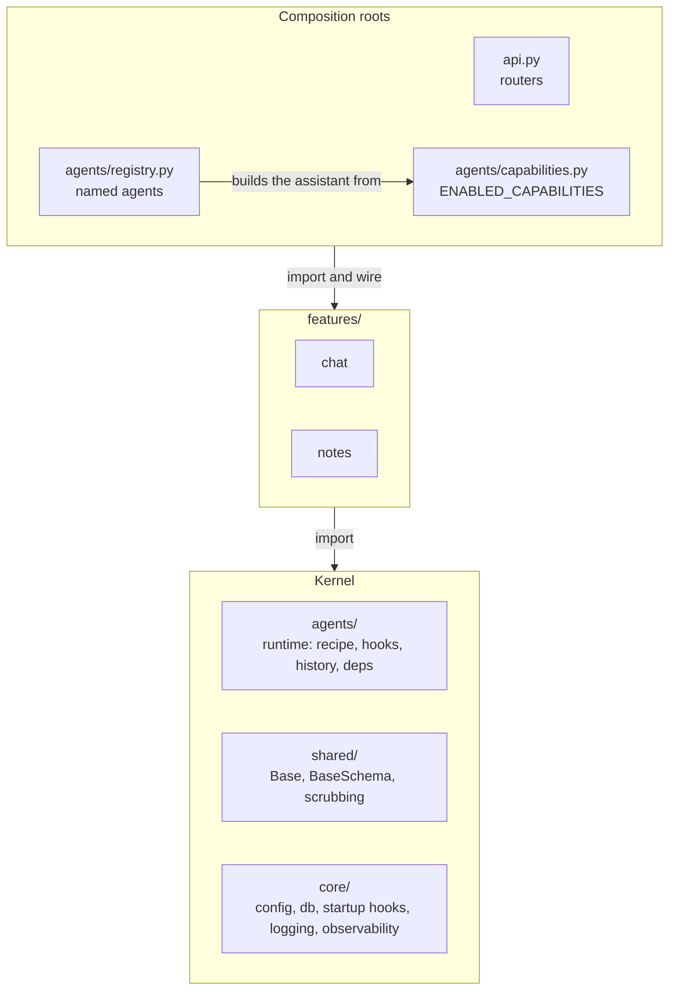

# Slices and the dependency rule

## Summary

Each domain is a vertical slice under `features/`, sitting on a small shared kernel. A slice may import the kernel, the kernel never imports a slice, and a slice never imports another slice. The only files allowed to see several slices at once are the composition roots, which is where all the wiring happens.

## Diagram

## How it works

A slice is a folder with the files it needs: `model.py`, `schema.py`, `service.py`, `router.py` where the slice has a table or routes, and `tools.py` and `capability.py` where it talks to an agent. There are two: `chat` (threads and messages, the title generator, and the streaming endpoint) and `notes` (the example domain, with its three tools). Route handlers stay thin and call the slice's `service.py`; tools do the same, through the session on `AgentDeps`.

The kernel is `core/` (settings, `db.py` with the request session and the one for work outside a request, the startup and shutdown hook registries, logging with credential redaction, and Logfire observability), `shared/` (the base model and schema classes, and the scrubber), and `agents/` (the agent runtime: the shared recipe in `assistant.py`, the named-agent registry, the tool and output error hooks, the history compactor, and `AgentDeps`).

Three files are composition roots and may import across slices:

- `api.py` includes each slice's router, and the health router from the kernel.
- `agents/capabilities.py` lists the capabilities the assistant is built from; the notes capability is the one entry.
- `agents/registry.py` maps agent names to builders and builds each one lazily on first use, so the app boots without a provider key. The assistant and the title agent are the two entries; an entry may reach another agent through `partial(get_agent, NAME)`, which is how a specialist would be handed to the capability that delegates to it.

Two other places list every slice for narrower reasons: `features/__init__.py` imports each slice's models so Alembic sees every table, and the frontend's `features/tool-panel-registry.ts` aggregates each UI slice's tool-to-panel map.

When a slice needs something another slice owns, `AGENTS.md` gives the shape: the type and a one-slot `register_<thing>` / `override_<thing>` seam go in `shared/`, and `api.py` registers the implementation at import. The template ships none, because its two slices need nothing from each other.

## Why it's built this way

`AGENTS.md` states the rule and the intent: copy a slice to add a domain, and register in one place so the wiring follows. `import-linter` enforces it from pre-commit with two contracts in `backend/pyproject.toml`: the slices are independent of each other, and `core`, `shared`, and `agents` never import `features`. Both contracts ignore the imports in the two composition roots inside the kernel, `agents/capabilities.py` and `agents/registry.py`. Today only the capability list imports a slice; the comment above the contracts says the registry's ignore only warns until a domain registers its own agent builder there. On the frontend, a Biome restricted-import rule makes `features/tool-panel-registry.ts` the only way into a slice.

The same shape is what lets onboarding cut features. The `agent` feature is the `agents/` kernel plus the `chat` slice and the notes tools; `embeddings` is the embedder, the search columns and their indexes, a route, and one tool inside the notes slice, fenced with markers, plus the frontend's search-results panel, whose registration line carries a `// sf:` marker; `scrubbing` is one module in `shared/` and its three call sites. Because slices do not reach into each other, each cut leaves an app that still imports.

[ADR 0001](../adr/0001-test-tiers-and-fakes.md) is where the rule meets the tests: a feature's shared fakes live in its own `tests/integration/features/<name>/conftest.py`, never the shared one, so a prune takes them with the feature; a feature woven into another slice, like `embeddings` into notes, keeps them in that slice's conftest, marked so the prune still finds them; and tests fake only at seams the source declares (a dependency, an `override`, a constructor argument). The registry docstring records why agents are faked through `get_agent(NAME).override(model=...)` and never by swapping an entry: the built agent is cached for the process.

## How to explain this

**In about a minute:**

> The backend is organized by feature, not by layer. Each domain, like chat or notes, is its own folder with its model, service, routes, and agent tools together. Underneath is a small kernel with config, the database sessions, and the agent runtime. The rule is that a feature can import the kernel, but never another feature, and the kernel never imports a feature. So how does the assistant get the notes tools? Through a composition root: one file lists the capabilities the assistant is built from, and the registry builds it from that list. There are three files like that, routers, capabilities, agents, and they're the only place you can see the whole system at once. Adding a domain is copying a folder and adding one line in each root that applies.

**Likely follow-ups:**

- **What stops someone adding a cross-feature import?** The linter. `import-linter` fails pre-commit and CI when a slice imports another slice or the kernel imports a slice, and Biome does the same for a frontend slice. The contracts name no slice, so they hold for every slice an instance adds.
- **Why are the capabilities listed in the runtime and not in the chat slice?** The chat slice runs whatever agent the registry hands it, and the list of what the assistant can do is a wiring decision, so it sits with the other wiring. Nothing else in `agents/` imports a feature.
- **How does a prune not break imports?** The cuttable code is either whole files listed in `.template/features.toml` or lines inside markers, and a conditional import always has its own import target, so stripping a marked line never leaves a name half-imported. `.template/verify_matrix.sh` builds and tests every combination.

## Sources

Written at commit `039bd25`.

- `docs/adr/0001-test-tiers-and-fakes.md`
- `backend/src/cortexdj/api.py`
- `backend/src/cortexdj/agents/capabilities.py`
- `backend/src/cortexdj/agents/registry.py`
- `backend/src/cortexdj/agents/hooks.py`
- `backend/src/cortexdj/core/db.py`
- `backend/src/cortexdj/core/startup.py`
- `backend/src/cortexdj/features/__init__.py`
- `backend/pyproject.toml`
- `.pre-commit-config.yaml`
- `frontend/biome.jsonc`
- `frontend/features/tool-panel-registry.ts`
- `.template/features.toml`
