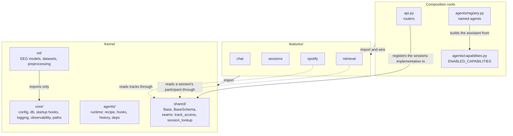

# Slices and the dependency rule

## Summary

Each domain is a vertical slice under `features/`, sitting on a small shared kernel. A slice may import the kernel, the kernel never imports a slice, and a slice never imports another slice. The only files allowed to see several slices at once are the composition roots, which is where all the wiring happens; a slice that needs another slice's data reads it through a seam in `shared/` that a composition root fills.

## Diagram

## How it works

A slice is a folder with the files it needs: `model.py`, `schema.py`, `service.py`, `router.py` where the slice has a table or routes, and `tools.py` and `capability.py` where it talks to an agent. There are four: `chat` (threads and messages, the title generator, and the streaming endpoint), `sessions` (EEG sessions and a thread's brain context, with its tools), `spotify` (the Spotify login, saved playlists, and the Spotify tools), and `retrieval` (the track index and the route and tool that rank it against a session's EEG). A slice adds files beyond the role files where it has something of its own to hold: `sessions/eeg_model.py` and `retrieval/encoder.py` hold the two models loaded at startup, and `spotify/client.py` decides which Spotify client a request gets. Route handlers stay thin and call the slice's `service.py`; tools do the same, through the session on `AgentDeps`.

The kernel is `core/` (settings, `db.py` with the request session and the one for work outside a request, the startup and shutdown hook registries, logging with credential redaction, and Logfire observability), `shared/` (the base model and schema classes, and the two seams), `agents/` (the agent runtime: the shared recipe in `assistant.py`, the named-agent registry, the tool and output error hooks, the history compactor, and `AgentDeps`), and `ml/` (inference for the quadrant classifier and the contrastive EEG-to-audio encoder: models, datasets, preprocessing, and checkpoint loading). `ml/` is the strictest part of the kernel: among this repo's packages it imports only `core/`.

Three files are composition roots and may import across slices:

- `api.py` includes each slice's router and the health router from the kernel, registers the two startup hooks that load the models, and registers the implementations behind the two seams.
- `agents/capabilities.py` lists the capabilities the assistant is built from; the sessions, spotify, and retrieval capabilities are the entries.
- `agents/registry.py` maps agent names to builders and builds each one lazily on first use, so the app boots without a provider key. The assistant and the title agent are the two entries; an entry may reach another agent through `partial(get_agent, NAME)`, which is how a specialist would be handed to the capability that delegates to it.

Two other places list every slice for narrower reasons: `features/__init__.py` imports each slice's models so Alembic sees every table, and the frontend's `features/tool-panel-registry.ts` and `features/header-slot-registry.ts` aggregate each UI slice's tool-to-panel map and its chat-header slots. The frontend slices are `sessions` and `retrieval`; the Spotify tools have no panels, so the Spotify settings page lives in the shared shell.

When a slice needs something another slice owns, `AGENTS.md` gives the shape: the type and a one-slot `register_<thing>` / `override_<thing>` seam go in `shared/`, and `api.py` registers the implementation at import. There are two, both implemented by `sessions`: `track_access` (find tracks by mood, read tracks, save a track's Spotify id), which is the only way `spotify` reaches tracks, and `session_lookup` (a session's participant id), which `retrieval` uses to find the DEAP file it re-reads the raw EEG from. A call before registration raises a `<Thing>NotRegistered` error, and a test swaps the implementation through `override_<thing>`.

## Why it's built this way

`AGENTS.md` states the rule and the intent: copy a slice to add a domain, and register in one place so the wiring follows. `import-linter` enforces it from pre-commit with three contracts in `backend/pyproject.toml`: the slices are independent of each other; `core`, `shared`, `agents`, and `ml` never import `features`; and `ml` imports only `core`. The first two ignore the imports in the two composition roots inside the kernel, `agents/capabilities.py` and `agents/registry.py`. Today only the capability list imports a slice; the comment above the contracts says the registry's ignore only warns until a domain registers its own agent builder there. On the frontend, a Biome restricted-import rule makes `features/tool-panel-registry.ts` and `features/header-slot-registry.ts` the only ways into a slice.

The seams exist for the same reason. The docstrings of `shared/track_access.py` and `shared/session_lookup.py` say what crosses and why: the sessions slice owns the tables, a feature may not import another, and only the few functions another slice needs are offered, so the rest of the sessions slice stays private to it.

[ADR 0001](../adr/0001-test-tiers-and-fakes.md) is where the rule meets the tests: a feature's shared fakes live in its own `tests/integration/features/<name>/conftest.py`, never the shared one; and tests fake only at seams the source declares (a dependency, an `override`, a constructor argument). The registry docstring records why agents are faked through `get_agent(NAME).override(model=...)` and never by swapping an entry: the built agent is cached for the process.

## How to explain this

**In about a minute:**

> The backend is organized by feature, not by layer. Each domain, like chat, sessions, Spotify, or retrieval, is its own folder with its model, service, routes, and agent tools together. Underneath is a small kernel with config, the database sessions, the agent runtime, and the EEG model inference code. The rule is that a feature can import the kernel, but never another feature, and the kernel never imports a feature. So how does the assistant get the sessions tools? Through a composition root: one file lists the capabilities the assistant is built from, and the registry builds it from that list. There are three files like that, routers, capabilities, agents, and they're the only place you can see the whole system at once. And when Spotify needs the tracks the sessions slice owns, it calls a small seam in the shared kernel, and the router file plugs the sessions implementation into it at import. Adding a domain is copying a folder and adding one line in each root that applies.

**Likely follow-ups:**

- **What stops someone adding a cross-feature import?** The linter. `import-linter` fails pre-commit and CI when a slice imports another slice or the kernel imports a slice, and Biome does the same for a frontend slice. The contracts name no slice, so they hold for every slice added later.
- **Why are the capabilities listed in the runtime and not in the chat slice?** The chat slice runs whatever agent the registry hands it, and the list of what the assistant can do is a wiring decision, so it sits with the other wiring. Nothing else in `agents/` imports a feature.
- **Why a seam in `shared/` and not just an import between two slices?** An import would make `spotify` depend on everything in `sessions` and stop either from changing alone. The seam names the three functions that cross, a test can swap them with `override_track_access`, and a call before `api.py` has registered them fails loudly with `TrackAccessNotRegistered`.
- **Why is `ml/` in the kernel and not inside a slice?** More than one place needs it and none may import another: the sessions slice holds the classifier, the retrieval slice embeds a session's EEG with the encoder, and the seeding script classifies every segment. It imports only `core/`, so the models can be read and tested without the app around them.

## Sources

Written at commit `977591d`.

- `docs/adr/0001-test-tiers-and-fakes.md`
- `backend/src/cortexdj/api.py`
- `backend/src/cortexdj/agents/capabilities.py`
- `backend/src/cortexdj/agents/registry.py`
- `backend/src/cortexdj/agents/hooks.py`
- `backend/src/cortexdj/core/db.py`
- `backend/src/cortexdj/core/startup.py`
- `backend/src/cortexdj/features/__init__.py`
- `backend/src/cortexdj/shared/`
- `backend/pyproject.toml`
- `.pre-commit-config.yaml`
- `frontend/biome.jsonc`
- `frontend/features/tool-panel-registry.ts`
- `frontend/features/header-slot-registry.ts`
