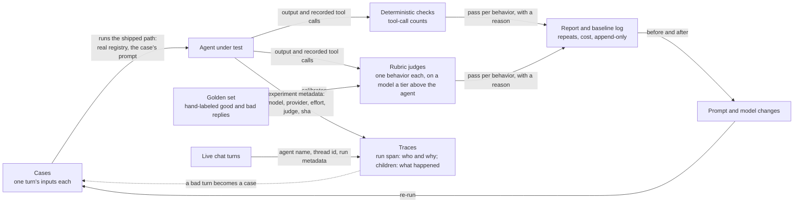

# The evaluation loop

## Summary

Every agent system needs an answer to two questions: is the agent getting better, and what did one run actually do? This repo answers them with one loop. Cases run the agent exactly as it ships, two kinds of grader score the result, a graded report drives the next prompt or model change, and every run, eval or live, leaves a trace that can become the next case. The one idea to remember: measure the agent the way it ships, grade with cheap checks first and a stronger model second, and calibrate the grader before you trust it.

## Diagram

## How it works

Each box in the loop maps to one place in this repo.

| Loop box | In this repo | Where to look |
|---|---|---|
| Cases | One dataset for the assistant. A case is one turn's inputs (`AgentTurn`: the prompt, plus whatever a case needs in place before the turn) and the evaluators that score it. The one case is a greeting, the copy-me pattern: a rubric judge for the behavior. No case covers the session, Spotify, or retrieval tools yet. | `backend/tests/evals/assistant_dataset.py`, `agent_run.py` |
| Agent under test | The eval task asks the registry for the assistant and runs the case's prompt through it, so an eval measures the agent that ships: its instructions, capabilities, and model. The greeting case reaches no database-backed tool, so the deps carry the mock session from `tests/factories.py`; a test whose cases need stored data runs its own task instead, opening a session per case from the `eval_sessions` fixture on the migrated test database (`agent_run.py` and `conftest.py` docstrings). The task records every tool call with what the tool answered, as an attribute the graders read. `run-evals.sh` migrates the test database and runs the tier with the keys from `.env`. | `backend/tests/evals/agent_run.py`, `conftest.py`, `test_assistant_eval.py`, `backend/scripts/run-evals.sh` |
| Deterministic checks | Plain functions wrapped as evaluators. The one there is, `MaxCallsOf`, counts a named tool's calls from the run's spans, which is why the eval tier configures tracing even with no token. Each returns a reason, so a failing row says what was wrong. The functions have unit tests; the eval tier only runs them, and no case uses one yet. | `backend/tests/evals/evaluators.py`, `backend/tests/unit/evals/` |
| Rubric judges | A `Rubric` is a statement true of a good reply; its judge passes or fails the reply and gives a reason. A rubric that cannot be graded from the output alone is shown the case's inputs and what the run's judged tools returned, so "in the input" covers the figures a reply quotes from a tool. Every judge runs on `EVAL_JUDGE_MODEL`, pinned apart from `AGENT_MODEL` and a tier above it, built once per process. | `backend/tests/evals/judges.py`, `backend/src/cortexdj/core/config.py` |
| Golden set | For each judged behavior, one reply a person would call good and one they would call bad, written against the same inputs the agent case uses. No agent runs: the judge is the thing under test, the human label is the expected output, and the test fails if any reply is graded against its label. It runs once, since the labels are fixed, before any rubric or judge-model change is trusted. A unit test fails when a judge in the dataset has no good-and-bad pair or is not on the pinned judge model, so that check costs nothing. | `backend/tests/evals/golden_set.py`, `test_golden_set.py`, `backend/tests/unit/evals/test_datasets.py` |
| Report and baseline log | The agent test prints a report and fails only when a case could not run or be scored. Pass rates are a measurement, not a gate: each case runs three times by default and five or more for a baseline. A before-and-after on a deliberate prompt or model change is recorded as a dated section in the append-only baseline log, with the agent and judge models it ran under. `EVAL_REPEAT` and `EVAL_CASES` are read through `run_options.py`, which fails on a value that would run nothing. | `docs/evals/baseline.md`, `backend/tests/evals/test_assistant_eval.py`, `run_options.py` |
| Prompt and model changes | What the loop exists to judge: a capability's instructions, the assistant's system prompt in the shared recipe, or a model setting. | `backend/src/cortexdj/features/sessions/capability.py`, `backend/src/cortexdj/agents/assistant.py`, `backend/src/cortexdj/core/config.py` |
| Traces | One call configures Logfire and instruments FastAPI, SQLAlchemy, and Pydantic AI, so request, run, tool, and model spans are recorded with nothing hand-written. The run span carries the agent name and the thread id; anything else a trace should be searchable by goes on the run as metadata. Eval runs are exported under their own environment, and the experiment view links a case to its run. Content capture stays on, behind Logfire's own scrubber, and the request span's URL has credential query parameters redacted. | `backend/src/cortexdj/core/observability.py`, `backend/tests/evals/conftest.py` |
| Live chat turns | The one live entry point that runs the agent: the chat stream. A trace from it is the raw material for a new case: the inputs are on the run span and the reply is on its children. | `backend/src/cortexdj/features/chat/stream.py` |

## Why it's built this way

- **Cases run the shipped path, not a mock of it.** The eval task calls the same registry as a chat turn, so a prompt change is scored as a user would see it (`agent_run.py` docstring; [ADR 0001](../adr/0001-test-tiers-and-fakes.md) for the tier).
- **Deterministic checks before judges.** A check costs nothing, never disagrees with itself, and says exactly what broke; a judge is for the behaviors a check cannot see. Both return a reason, so the report reads as a list of broken behaviors, not scores (`evaluators.py` and `judges.py` docstrings).
- **The judge is a tier above the agent and never follows its model.** A judge on the same model as the agent shares its habits and its blind spots, and one that follows `AGENT_MODEL` changes grader whenever the agent's model does. [ADR 0004](../adr/0004-eval-judges-a-tier-above-the-agents.md) pins the judge apart from the agents and names the pairing a convention rather than a code check.
- **The golden set gates the judge, not the agent.** A judge that misgrades a hand-labeled reply makes every score it gives meaningless, so the golden set runs before a rubric or judge-model change is trusted, and a rubric with no golden pair is not calibrated ([ADR 0004](../adr/0004-eval-judges-a-tier-above-the-agents.md)). The unit tier enforces that last rule, and that every judge runs on the pinned judge model (`test_datasets.py` docstring).
- **Pass rates are a measurement, not a gate.** The dataset is small and a model's run-to-run spread on it is wide, so a threshold would fail on noise. The tier prints a report, fails only when a case cannot run, and keeps a dated baseline log so a change is compared before and after on the same cases at a higher repeat count (`test_assistant_eval.py` docstring; `DEVELOPMENT.md`, Evals). The tier is outside the ordinary checks because it costs money.
- **Tracing adds the run's facts and nothing the libraries record already.** [ADR 0003](../adr/0003-run-metadata-not-a-custom-chat-turn-span.md): the instrumentors already record the agent name, the thread, tool arguments and results, and usage. Anything added goes on the run as metadata, and experiment metadata names the model, effort, judge, and commit so eval runs compare. No custom spans.

## How to explain this

**In about a minute:**

> The agent gets measured the way it ships. An eval case is one turn's inputs, and it runs through the real registry, the same agent a chat turn gets. Each run gets graded twice. First by cheap deterministic checks, like which tools were called and how often. Then by rubric judges, one behavior each, for the things code can't see, like whether a greeting is friendly. The judge runs on a stronger model than the agent and is pinned apart from it, so it isn't grading its own habits and a model swap doesn't quietly change the grader. And before I trust a judge at all, I run it on a golden set: a hand-written good and bad reply for every behavior. If it misgrades one, its scores on real replies mean nothing. Pass rates are a measurement, not a gate: the set is small and the spread is wide, so I repeat runs and keep a dated before-and-after log instead of asserting a threshold. The other half of the loop is tracing. The standard instrumentation records the request, the run, every tool call, and every model call; the run carries the agent name and the thread, and eval runs carry the model and commit too, so experiments compare. A bad live trace is where the next case comes from.

**Likely follow-ups:**

- **Why both deterministic checks and judges, and which runs first?** Checks first: they are free, repeatable, and precise about what broke, so a judge is only spent on behaviors a check cannot express. Both return a reason, so a failing row reads as a broken behavior rather than a score.
- **How do you trust the judge?** It runs on a model a tier above the agent so it does not share its blind spots, it is pinned so a model swap never changes who grades, and the golden set of hand-labeled replies runs before any rubric or judge change is trusted.
- **Why isn't this in CI, and what would gate a deploy?** It calls real models, so it costs money and the pass rate has a wide run-to-run spread on a small set. What could gate a deploy is the golden set, which is deterministic in its labels, plus a baseline run at a high repeat count compared against the last recorded one; a single-run threshold would fail on noise.
- **What does a trace need that the libraries don't record for you?** Whatever a run depends on that the instrumentors cannot see: who the run was for, which rule routed it. That rides on the run as metadata. For eval runs, the model, effort, judge, and commit, so experiments compare.
- **What would production add?** Online evals: sample live traces, run the same judges on them, and watch the rates drift. A feedback path from the UI that files a trace as a new case. More cases, since more repeats narrow the spread but only more cases widen what is measured; the first would cover the session and playlist tools. And content capture off, or scrubbing of user text before the run, once the users are real.

## Sources

Written at commit `87d6eba`.

- `docs/adr/0001-test-tiers-and-fakes.md`
- `docs/adr/0003-run-metadata-not-a-custom-chat-turn-span.md`
- `docs/adr/0004-eval-judges-a-tier-above-the-agents.md`
- `docs/evals/`
- `backend/tests/evals/`
- `backend/tests/unit/evals/`
- `backend/scripts/run-evals.sh`
- `backend/src/cortexdj/core/observability.py`
- `backend/src/cortexdj/core/config.py`
- `backend/src/cortexdj/agents/assistant.py`
- `backend/src/cortexdj/features/chat/stream.py`
